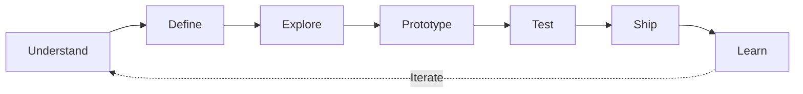

# Hi, I'm K H Arjun 👋

**Product Designer crafting thoughtful, usable, and scalable digital experiences.**

<!-- OPTIONAL: Replace the placeholder links, then remove this comment.

-->

---

## About me

I’m a **product designer** focused on making complex products feel simple. I enjoy connecting user needs, business goals, and technical realities to create experiences that are useful, intuitive, and built to evolve.

- 🔍 I approach problems with curiosity and a user-first mindset
- 🧭 I turn ambiguous requirements into clear product flows
- 🧩 I think in systems, not isolated screens
- 🤝 I value close collaboration with product and engineering teams
- 🌱 I’m continuously learning, testing, and refining my craft

## What I bring to a product

| Discover | Define | Design | Deliver |
| :---: | :---: | :---: | :---: |
| User research | Problem framing | UX & interaction design | Developer handoff |
| Competitive analysis | Journey mapping | Prototyping | Design QA |
| Stakeholder insights | Information architecture | Design systems | Iteration & measurement |

## My design process

<strong>🔎 Understand & define</strong>

 

I begin by learning about the people, context, constraints, and desired outcomes. I synthesize those inputs into a focused problem statement and a shared definition of success.

<strong>✏️ Explore & prototype</strong>

 

I explore multiple directions, map critical flows, and build prototypes at the right level of fidelity to answer the most important questions quickly.

<strong>🧪 Test, ship & learn</strong>

 

I validate assumptions, collaborate closely during implementation, review the shipped experience, and use feedback to guide the next iteration.

## Design principles

> **Clarity over decoration**  
> Every element should help people understand or act.

> **Systems over one-offs**  
> Reusable patterns create consistency and help products scale.

> **Evidence over assumptions**  
> Good decisions combine user insight, product context, and measurable outcomes.

> **Collaboration over handoff**  
> The strongest products emerge when design, product, and engineering build together.

<!-- OPTIONAL: Add your real tools and remove any that do not apply.
## Tools I use

-->

<!-- OPTIONAL: Duplicate this block for each real case study.
## Selected work

### Project name

**One-line summary of the problem and outcome.**

- **Role:** Product Designer
- **Focus:** Research · Interaction Design · Prototyping
- **Impact:** Add one measurable result here
- [View case study →](https://YOUR-CASE-STUDY-URL.com)
-->

## Currently exploring

- Designing clearer workflows for complex products
- Building accessible, reusable interface patterns
- Improving product decisions through rapid prototyping
- Strengthening collaboration between design and engineering

## Let’s create something meaningful

I’m always interested in thoughtful product conversations, design challenges, and opportunities to build experiences that make a difference.

### [Say hello](mailto:kharjun48@gmail.com)

Designed with curiosity, clarity, and care.

